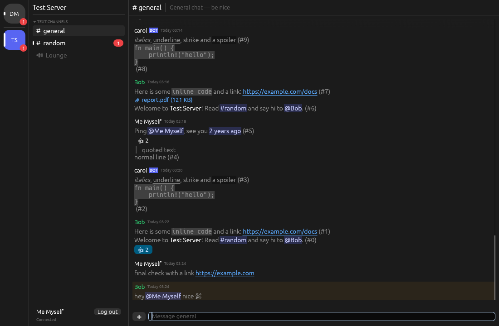

# discord-native

A lightweight, native Discord client written in Rust. It aims to be useful first, then light on CPU, then light on RAM.



## Features

- Log in with a **user token or a bot token**. You can save it in a file only your user can read, or pass it in the `DISCORD_TOKEN` environment variable.
- Server list, channel list with categories (click a category to collapse it), and direct messages and group DMs sorted by most recent activity.
- **Permissions are calculated on the client** (roles plus channel overwrites), so channels you can't see are hidden, and the message box is disabled where you can't send.
- **Unread and mention tracking**: uses Discord's read state for user accounts, marks channels read when you view them, and shows the unread count in the window title. Respects muted servers and channels.
- Message history with automatic loading of older messages when you scroll up. Your scroll position is kept when older messages load.
- **Markdown**: bold, italics, underline, strikethrough, spoilers, inline code and code blocks, quotes, headings and lists. Also renders user, channel and role mentions, custom emoji, `<t:…>` timestamps, and clickable links.
- Send, **reply**, **edit** (or press <kbd>↑</kbd> in an empty message box to edit your last message), and **delete** messages. You can also copy text, message links or IDs.
- **Reactions**: shows reactions, click one to toggle yours, and quick reactions in the right-click menu.
- **Typing indicators** in both directions.
- **File uploads**: drag files onto the window, or use ➕ and enter a path.
- Usernames are coloured by role and use server nicknames. Bots get a BOT tag, and messages that mention you are highlighted.
- Attachments and embeds appear as links and compact cards.
- Recovers from dropped connections: resumes the session, reconnects with backoff, and detects dead connections that stop answering heartbeats.

## Why it's light

| | How |
|---|---|
| **CPU at idle: zero** | egui only redraws on input, on a network event, or when a timer asks for it. The cursor blink is turned off because it would otherwise force a full redraw twice a second. With nothing happening the process uses no CPU (measured: 0 frames and 0 CPU ticks over 10 s). |
| **Cheap redraws** | Each message's markdown is parsed once and cached. Messages scrolled off screen use a cached height and skip text layout entirely. |
| **One network thread** | A single-threaded tokio runtime handles the gateway websocket and every REST call. The UI never waits on the network. |
| **Compressed gateway** | `zlib-stream` transport compression with one shared inflate buffer. The buffer is shrunk again after large payloads such as READY. |
| **Lean parsing** | Only the fields the client uses are deserialized. Unknown fields are skipped without allocating, and fields are lenient so a change to Discord's format can't break a whole payload. |
| **Bounded memory** | At most 8 channels keep message history. A channel you leave is trimmed to 50 messages. Images are never downloaded or decoded. |
| **Small renderer** | OpenGL (`glow`), no wgpu. No MSAA, depth or stencil buffers, and no accesskit. |

In testing (Xvfb with Mesa's software renderer) the process used about **39 MB of private (anonymous) memory** after loading a channel. The total RSS was higher because it includes Mesa's shared driver libraries. A typical Electron client uses 300–600 MB.

## Build

Requires Rust 1.88+ (edition 2024).

```bash
cargo build --release
./target/release/discord-native
```

Linux needs the usual windowing libraries at runtime: `libxkbcommon-x11`, `libGL`/`libEGL`, and Wayland or X11. Both Wayland and X11 are supported.

The release profile uses fat LTO, a single codegen unit, `panic = "abort"`, and strips symbols.

## Configuration

| Variable | Meaning |
|---|---|
| `DISCORD_TOKEN` | Token to use. Takes priority over the saved token. A `Bot ` prefix marks it as a bot token. |
| `DISCORD_BOT=1` | Treat `DISCORD_TOKEN` as a bot token. |
| `DISCORD_API_BASE` | REST base URL (default `https://discord.com/api/v10`). Useful for Discord-compatible servers or testing. |
| `DISCORD_GATEWAY` | Gateway base URL (default `wss://gateway.discord.gg`). |
| `DISCORD_NATIVE_DEBUG_REPAINT=1` | Print every frame and why it was redrawn. Useful for spotting idle CPU regressions. |

A saved token is stored in `$XDG_CONFIG_HOME/discord-native/token` (`~/.config/...`, or `%APPDATA%` on Windows, or `~/Library/Application Support` on macOS) with mode `0600`. **Log out** deletes it.

Bot accounts need the **Message Content** privileged intent to see message text. If it isn't enabled, the client reconnects without it and tells you.

## ⚠️ User tokens

Using a user-account token with any third-party client goes against Discord's Terms of Service and can get the account flagged or banned. Bot tokens are fully supported and allowed. The login screen shows this warning too.

## Not supported (yet)

Voice and video, threads and forum posts, the member list, inline image previews (left out on purpose to save RAM; attachments open in your browser), message search, desktop notifications, and an emoji picker.

## Layout

```
src/
  main.rs      window/renderer setup
  ui.rs        egui front-end (reactive rendering, message list, composer)
  store.rs     client state, permissions, unread tracking, bounded caches
  net.rs       gateway (zlib-stream, heartbeat, resume) + REST with rate-limit retry
  markdown.rs  Discord markdown → cached egui LayoutJob with clickable links
  model.rs     minimal lenient Discord API types
  config.rs    token storage
```

Run the tests with `cargo test`.
